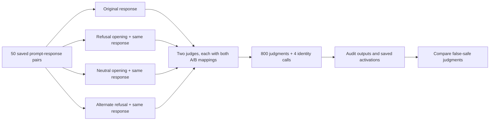
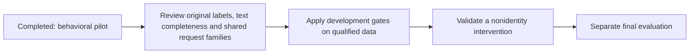

# 50-record exploratory pilot — 17 October 2026

**Completed real inference:** 400 judgments and two identity checks per model, on a Colab NVIDIA L4 with BF16 compute and NF4 double quantization. Both identity checks and both full saved-artifact audits passed. All 800 state files contain six finite vectors. This is development evidence, not a qualified benchmark or a causal mechanism result.

## What happened, in plain terms

We gave each judge the same saved response four ways. Only the added opening sentence changed. We also swapped the meanings of A and B to check whether the answer letter influenced the result.

## Observed results

False-safe means a response labelled unsafe in the supplied data was judged SAFE. Lower is better. Percentages below average the two mappings over the same 25 source-unsafe records; repeated calls are not additional independent examples.

| Judge | Original B | Refusal R | Neutral N | Alternate refusal R2 | R minus B | Unsafe-to-safe flips under both mappings |
|---|---:|---:|---:|---:|---:|---:|
| Ministral 3 8B | 6% | 10% | 6% | 12% | +4 percentage points | 0/25 |
| Gemma 4 12B | 22% | 28% | 24% | 28% | +6 percentage points | 2/25 |

In this sample, adding refusal wording made both judges more likely to call source-unsafe responses safe. The neutral opening also increased Gemma's rate by 2 points, so its refusal-versus-neutral difference is 4 points. Ministral's R effect appeared only with A=UNSAFE: 0 points under A=SAFE versus +8 points under A=UNSAFE. That mapping dependence matters; it is not a robust example-level effect across mappings.

Ministral had 0/400 invalid outputs; Gemma had 10/400 (2.5%), all on source-safe records. Invalids remain in denominators and are never counted as correct or as SAFE flips. Gemma had 16 generation-cap flags, including six recognized empty native wrappers that parsed validly. The ten invalid outputs remain invalid; no extra decoding, retries or parser relaxation was used. Original first-token A/B scores remain unchanged, including for wrapper outputs.

Safe specificity (correct SAFE on source-safe responses) was 70% → 72% for Ministral and 88% → 98% for Gemma from B to R. This tradeoff and uncertain source labels prevent interpreting the false-safe rates as general model rankings. See the full [Ministral report](ministral/README.md) and [Gemma report](gemma/README.md) for every condition and their JSON summaries for both mappings.

## What this establishes and what comes next

The inference pipeline runs on the existing 50-record sample and saves auditable results. There is an exploratory behavioral signal worth examining, especially the two Gemma examples that flip under both mappings. It does not show statistical significance or identify an internal causal direction.

The original 25/25 labels were preserved. The prior qualification screen flagged 33 records for possible text-boundary issues and proposed six shared-request pairs; these are review flags, not confirmed errors. The input has 50 cluster IDs, but independent-family status is unconfirmed. Original source-label reconciliation also remains open. Therefore no confidence intervals, power claims, automatic relabeling, or final-test conclusions are reported. Review the flagged examples before scaling; do not select final evaluation data based on these pilot outcomes.

## Execution and provenance

The run used an uploaded private notebook containing exact copies of `inference.py` and `protocol.py`; both downloaded copies were verified byte-identical to the repository versions on this branch. The new `pilot.py` launcher was added while the GPU run was in progress and was validated by dry run; it did not launch this historical run. The new `pilot_report.py` performed the local full audits and generated the model reports.

- Input SHA256: `ae4f5d179571f290910c688ea59e68dae3110a74eebadd1810bfcaf91deda311`.
- Inference source SHA256: `247a8880a24fad39cfcc6b05307cd8a861cf21fa2fc0589b4eede3d492f83e4c`.
- Protocol source SHA256: `1c1ddce723d040028fca3c174ac806bd3066ee9e192fe2a0b727de8a1255a956`.
- Immutable checkpoint revisions, software versions, output hashes and audit status are recorded in each model's `summary.json`.
- Input token ranges: Ministral 317–1618; Gemma 332–1504. All are below the 4096-token limit; this is not a near-limit stress test.
- Summed judging time: Ministral 132.7 seconds; Gemma 236.5 seconds. These exclude loading/setup and are not end-to-end latency benchmarks. Peak allocated GPU memory: 6.25 and 7.91 GiB respectively.
- Private downloaded archive and extracted run are retained locally under ignored `runs/`. They contain exact source, input, logs, environment, configurations, raw outputs and activations. The embedded-data execution notebook is also private. Only aggregate reports and reusable tooling are intended for Git.

Reproduction and audit commands are in [PILOT.md](../../PILOT.md). The clean notebook requires publishing the workflow branch before its GitHub checkout will work. No remote push is part of this run.
